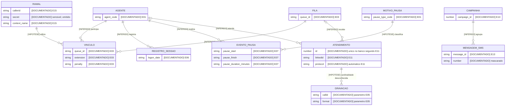

# Modelo de dados

[DOCUMENTADO] Campos e tipos completos estão nas tabelas de `02-endpoints.md`, nos schemas de `openapi.yaml` e em `types/beatrix.ts`. Fonte única: [Postman](https://documenter.getpostman.com/view/47894186/2sB3HjLgWE); os IDs abaixo apontam para `evidence.json`.

[INFERIDO] O modelo abaixo representa conceitos de integração, não tabelas comprovadas do banco. Campos encontrados apenas em exemplos não são necessariamente obrigatórios. Identificadores numéricos entre aspas permanecem strings para preservar zeros à esquerda. Nenhuma chave estrangeira ou cardinalidade física foi publicada.

| Conceito | Campos e evidência | Chave / relação |
|---|---|---|
| Agente | [DOCUMENTADO] `agent_code` nas rotas E01–E04; `code` E09/E06; `id` E19–E21; `agent_name` em relatórios | [INFERIDO] Representam identificações de agente; equivalência entre `id`, `code` e `agent_code` desconhecida |
| Fila | [DOCUMENTADO] `queue_id` E03/E04/E24; `queue` E09/E06; `queue_name` E12/E26; `queues` E12 | [DOCUMENTADO] Resolução entre ID e nome desconhecida; nenhum catálogo de filas |
| Vínculo agente–fila–ramal | [DOCUMENTADO] E03 recebe `queue_id`, `extension`, `penalty`; E09 recebe `queue`, `extension`, `code` | [INFERIDO] Entidade associativa provável; N:N agente–fila não demonstrado por exemplos com o mesmo agente em filas distintas |
| Ramal | [DOCUMENTADO] E15: `category`, `callerid`, `ddr`, `secret`, `context_name`, `cost_center_name`, `company_name`, `operator_name`; strings nos exemplos | [DOCUMENTADO] Chave primária de ramal desconhecida; `secret` é credencial, valor omitido |
| Estado do ramal | [DOCUMENTADO] E22: `extension`, `status`, ambos strings; exemplos ONLINE/OFFLINE | [INFERIDO] Relacionado ao ramal; equivalência com estado do agente desconhecida |
| Pausa / motivo | [DOCUMENTADO] E01: `pause_type_code`; E07: `pause`, `pause_start`, `pause_finish`, `max_minutes`, `pause_duration_minutes`, `approved_by_supervisor` | [INFERIDO] Evento de pausa e catálogo de motivos distintos; relação código–nome e ID do evento desconhecidos |
| Registro de sessão | [DOCUMENTADO] E06: `ramal`, `code`, `agent_name`, `queue`, `logon_date`, `logoff_date` | [INFERIDO] Histórico de sessões por agente/fila; chave desconhecida |
| Chamada PABX | [DOCUMENTADO] E16 retorna `callid` string e `status` número; E17 consulta por esse callid | [DOCUMENTADO] Descrição E16 chama callid de identificador único; escopo de unicidade e persistência desconhecidos |
| Atendimento | [DOCUMENTADO] E11: `id` número, `agent_code`, `queue`, `linkedid`, `call_datetime`, `client_name`, `client_extra_info`, `call_motive`, `call_obs`, `protocol`, `cpf_cnpj`, `call_status` strings | [DOCUMENTADO] `id` é descrito como identificador único no banco; protocolo é descrito como automático. Relação exata entre `id`, `linkedid`, `callid` e `protocol` desconhecida |
| Registro de chamada analítico | [DOCUMENTADO] E12: `calldatetime`, `billsec`, `wait`, `agent_code`, `src`, `dst`, `queue_name`, `operator_name`, `trunk`, `bound`, `call_type_name`, `status`, `linkedid`, `file`, `record`, `hangupcause`, `event`, `campaign_name`, `protocol` | [INFERIDO] Projeção de relatório; não equivale necessariamente a um registro persistido independente |
| Gravação | [DOCUMENTADO] E05 recebe `callid`, `format`; E12 analítico possui `file`, `record` | [DOCUMENTADO] ID próprio, URL, conteúdo e cardinalidade por chamada desconhecidos; vínculo `file` → download não especificado |
| Campanha / mensagem SMS | [DOCUMENTADO] E13 recebe `campaign_id` número e `messages[]` com `number`/`message`; retorna `messages_returns[]` com `number`, `message_id`, `send` em parte dos itens | [INFERIDO] Campanha agrupa mensagens; `campaign_id` tem significado divergente em E20/E21, onde o comentário diz empresa |
| Pesquisa de satisfação | [DOCUMENTADO] E25/E26 têm filtros de relatório, sem exemplos de resposta | [DOCUMENTADO] Perguntas, respostas, notas, chaves e cálculo de indicadores desconhecidos |

[DOCUMENTADO] `logoff_date`, `max_minutes` e `campaign_name` só aparecem como null. [INFERIDO] O tipo não nulo fica `unknown`, sem inventar string ou number. `pause_duration_minutes` é string decimal; `approved_by_supervisor` é string, não boolean. `send` em SMS é string e falta no primeiro item. A existência de null não estabelece obrigatoriedade do campo.

[DOCUMENTADO] Domínios conhecidos: E19 descreve status de agente `0,1,2,5,-1` e paused `0,1`; E17 descreve status PABX `2,5,7,8,9`; E22 exemplifica ONLINE/OFFLINE; E05 indica ogg/wav. [INFERIDO] A lista de status pode ser parcial. `call_status` E11 e `status` textual E12 não formam enums exaustivos. Filtros de relatório também não possuem enums fechados.

[INFERIDO] ER conceitual: todas as relações e cardinalidades abaixo são candidatas, **não constraints comprovadas**. Os atributos são documentados; `CODIGO_*` representa o campo publicado e não uma PK inventada. A associação com gravação é mantida como possibilidade N, pois a quantidade real é desconhecida.

[DOCUMENTADO] Relatório existe como resultado de consulta. [INFERIDO] Não há evidência de entidade Relatório persistida, job de geração ou identificador de relatório. Agente, fila, ramal, pausa e chamada têm apoio documental; entidades persistidas e implementação da pesquisa continuam desconhecidas.
