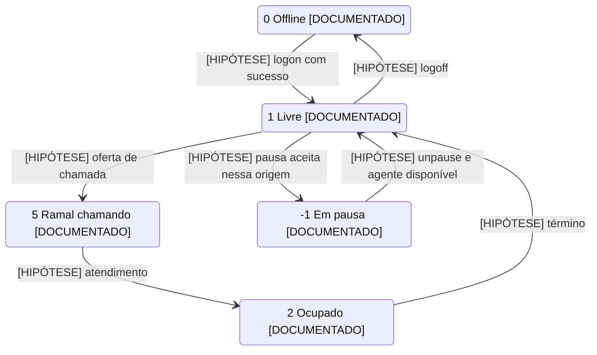
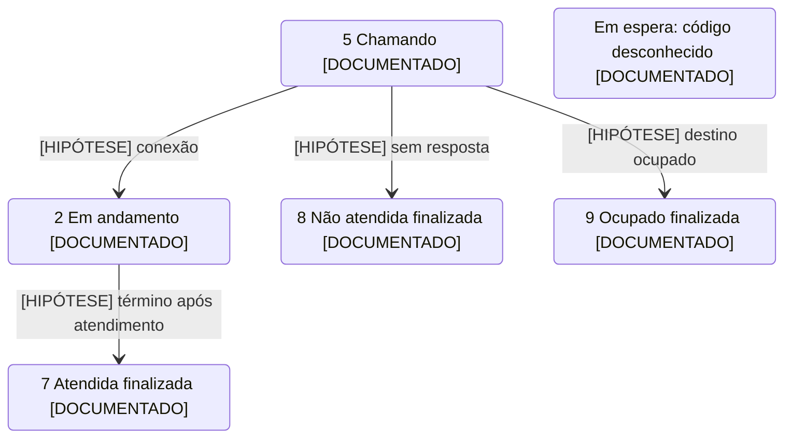
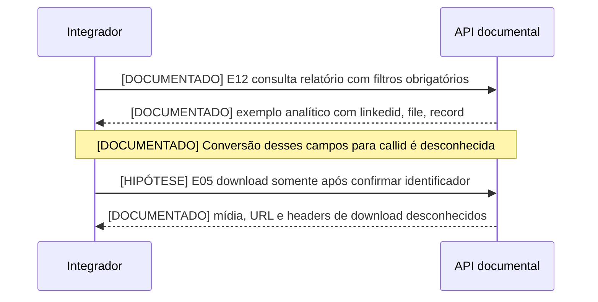

# Estados e fluxos

[DOCUMENTADO] Fonte: [Postman Beatrix](https://documenter.getpostman.com/view/47894186/2sB3HjLgWE), E01–E04, E09/E10 e E16–E24. Estados são descritos; não existe matriz de transições permitidas, pré-condições ou tratamento de concorrência.

| Agente E19 | Significado publicado |
|---|---|
| 0 | [DOCUMENTADO] Offline |
| 1 | [DOCUMENTADO] Livre |
| 2 | [DOCUMENTADO] Ocupado |
| 5 | [DOCUMENTADO] Ramal chamando |
| -1 | [DOCUMENTADO] Em pausa |
| paused 0 / 1 | [DOCUMENTADO] Não / sim; precedência em relação a status desconhecida |

[INFERIDO] “Ocupado” pode corresponder a em chamada, mas não comprova atendimento de voz, pois não há resposta de exemplo nem definição exclusiva. Login em fila não garante disponibilidade imediata. Despausar não garante retorno a Livre. Os comandos de pausa existem; seus estados de origem válidos são desconhecidos.

[HIPÓTESE] Diagrama de ciclo de agente para discussão com o mantenedor. **Todas as setas são hipóteses**, não permissões de execução. Nenhum estado inicial é assumido.



| Chamada PABX E17 | Significado publicado |
|---|---|
| 2 | [DOCUMENTADO] Chamada em andamento |
| 5 | [DOCUMENTADO] Chamando |
| 7 | [DOCUMENTADO] Atendida, já finalizada |
| 8 | [DOCUMENTADO] Não atendida, já finalizada |
| 9 | [DOCUMENTADO] Ocupado, já finalizada |

[DOCUMENTADO] **7 não significa chamada atualmente em atendimento**: o texto diz finalizada. E16 retorna 5, mas seu comentário é genérico e impreciso; a descrição E17 é a fonte do mapeamento. E24 consulta chamadas em espera sem publicar estados ou resposta. Estado perdido/abandono aparece em linguagem de relatório, sem correspondência comprovada a 8. Em espera, em atendimento e finalizada não têm um único enum transversal publicado.

[HIPÓTESE] Caminhos prováveis PABX; transições permitidas desconhecidas. Espera é mostrada isolada porque não há evidência para ligá-la aos códigos PABX.



[DOCUMENTADO] Única dependência explícita de retorno → próxima consulta: E17 manda substituir `:id` pelo `callid` retornado em E16. [INFERIDO] E18 provavelmente usa o mesmo callid, pois pede ID da chamada; essa equivalência não é explicitada como em E17. E16 possui exemplo denominado Desabilitado: disponibilidade atual desconhecida.

```mermaid
sequenceDiagram
    participant I as Integrador
    participant P as API PABX
    I->>P: [DOCUMENTADO][SENSÍVEL] E16 POST /api/pabx com extension e number
    P-->>I: [DOCUMENTADO] exemplo HTTP 200 com callid e status 5
    Note over I,P: [DOCUMENTADO] Exemplo denominado Desabilitado; não executado
    I->>P: [DOCUMENTADO] E17 GET /api/pabx/{id} usando callid
    P-->>I: [DOCUMENTADO] códigos descritos; payload desconhecido
    opt Encerramento solicitado
        I->>P: [INFERIDO][SENSÍVEL] E18 POST /api/pabx/{id}/close com mesmo callid
        P-->>I: [DOCUMENTADO] resposta desconhecida
    end
```

[INFERIDO] Sequência de gestão de agente abaixo é um roteiro candidato, não ordem obrigatória. E09 e E03 podem ter sobreposição; não há prova de que seja necessário usar ambos. Origem de IDs, catálogo de pausas, resposta de login e pré-condições permanecem desconhecidos. Não existem operações documentadas para atender ou transferir chamada nesta collection.

```mermaid
sequenceDiagram
    participant S as Supervisor ou integrador
    participant A as API
    Note over S,A: [DOCUMENTADO] Token obtido fora da API, com suporte NPX
    S->>A: [DOCUMENTADO][SENSÍVEL] E09 logon com code, password, queue, extension
    A-->>S: [DOCUMENTADO] só exemplo de erro; sucesso e ID de sessão desconhecidos
    opt Vínculo adicional se o mantenedor confirmar a necessidade
        S->>A: [INFERIDO][SENSÍVEL] E03 add_to_queue
        A-->>S: [DOCUMENTADO] exemplo message Sucesso e status 1; HTTP desconhecido
    end
    S->>A: [DOCUMENTADO][SENSÍVEL] E01 pause com pause_type_code
    A-->>S: [DOCUMENTADO] exemplo status 1
    S->>A: [DOCUMENTADO][SENSÍVEL] E02 unpause
    A-->>S: [DOCUMENTADO] exemplo status 1
    Note over S,A: [DOCUMENTADO] Atendimento e finalização automática não têm fluxo especificado
    S->>A: [DOCUMENTADO][SENSÍVEL] E10 logoff com ID de agente na fila
    A-->>S: [DOCUMENTADO] resposta desconhecida; origem desse ID desconhecida
```

[INFERIDO] Grafo de dependências de dados: E11/E12 expõem `linkedid` e E12 expõe `file`, mas a equivalência com `callid` de E05 não foi publicada. Logo, não é seguro ligar automaticamente relatório → download. E05 chama o parâmetro de `callid` e sua descrição diz CallerId, aumentando a ambiguidade.


