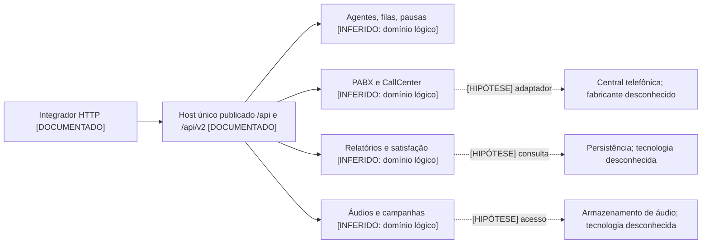

# Arquitetura provável

[DOCUMENTADO] Esta reconstrução usa exclusivamente a [documentação Postman](https://documenter.getpostman.com/view/47894186/2sB3HjLgWE). Não há código de servidor, tráfego de operação, binário ou acesso à central telefônica. O conteúdo de `raw/` é captura documental, não execução da API.

| Conclusão candidata | Evidência | Limite |
|---|---|---|
| Backend Ruby | [INFERIDO] E08/E09 contêm erros com `undefined method` e `nil:NilClass` | [DOCUMENTADO] É texto de exemplo; stack em produção e versão desconhecidos |
| Ruby on Rails ou stack semelhante | [INFERIDO] E16 traz nomes de cookie de sessão, `X-Runtime`, `X-Request-Id` e headers comuns de aplicação Rails; erros E08/E09 reforçam Ruby | [DOCUMENTADO] Framework não é declarado; headers isolados não provam Rails. Valores de cookie omitidos |
| Central telefônica por trás da API | [DOCUMENTADO] A introdução PABX fala em central interna; E16 inicia chamada e E18 encerra | [DOCUMENTADO] Produto, protocolo e topologia desconhecidos |
| Família Asterisk ou integração compatível | [INFERIDO] E11/E12 usam `linkedid`, `billsec`, `hangupcause`, `CDR`; E15 possui `context_name`, `callerid`, `secret`; E03 possui `penalty` | [DOCUMENTADO] Asterisk, FreePBX, AMI e ARI não são mencionados explicitamente; não é possível distinguir fornecedores ou adaptadores pelos nomes |
| Logs/históricos separados do estado atual | [INFERIDO] E06/E07 são eventos temporais; E12 é relatório, enquanto E19/E24 são consultas de estado | [DOCUMENTADO] Armazenamento, sincronização e persistência desconhecidos |
| Banco persistente | [DOCUMENTADO] E11 descreve `id` no banco e protocolo automático | [DOCUMENTADO] SGBD, schema, ORM, índices e isolamento desconhecidos |
| Separação lógica por domínio | [DOCUMENTADO] Prefixos agents, callcenter, call_center_reports, pabx, queues, extensions, campaigns, audios e satisfaction_survey_generic_reports | [INFERIDO] Podem corresponder a módulos/controladores; não provam serviços independentes |
| Evolução incremental | [INFERIDO] Coexistência de rotas sem versão e v2, duplicação de pausa e nomes inconsistentes | [DOCUMENTADO] Compatibilidade, migração e depreciação desconhecidas |

[HIPÓTESE] Pode haver monólito web com adaptador para telefonia e banco de relatórios. Um gateway encaminhando para vários serviços também é compatível com as mesmas evidências. **Monólito versus microserviços é desconhecido**; um único host não resolve a questão.

[HIPÓTESE] Comandos de chamada ou SMS podem usar execução assíncrona e fila de trabalho. Não há job ID, status de job ou nome de broker no contrato. “Fila” nos endpoints significa fila de atendimento telefônico e não demonstra RabbitMQ, Kafka, Redis ou outra fila de mensagens.

[HIPÓTESE] Monitoramento pode usar cache de estado, eventos da central ou consulta direta. Não há evidência que escolha uma dessas alternativas. Webhook, WebSocket, SSE, AMI e ARI permanecem desconhecidos; não foram reconstruídos como interfaces existentes.

[INFERIDO] O desenho abaixo mostra apenas fronteiras conceituais sustentadas pelos domínios publicados. Cada implementação interna está marcada como hipótese; as setas internas não são fluxos observados.

[INFERIDO] Para reimplementar, esses domínios são candidatos de organização interna, mas não substituem requisitos. Não há base documental para replicar schema físico, cálculo completo dos relatórios, agendamento, roteamento, tarifação ou dialplan. A especificação entregue cobre a superfície observada e deixa esses detalhes como lacunas.
